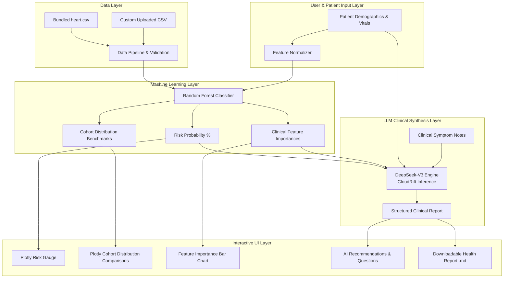

# 🩺 Smart Health Companion

[](https://www.python.org/)
[](https://streamlit.io/)
[](https://scikit-learn.org/)
[](https://inference.cloudrift.ai/)
[](LICENSE)

An intelligent, full-stack cardiovascular risk assessment and clinical AI companion platform. The application combines calibrated **Machine Learning (Scikit-Learn Random Forest Classifier)** on real clinical cohorts with **Generative Clinical AI (DeepSeek-V3 via CloudRift)** to provide patients and healthcare providers with interpretable risk scores, physiological benchmark distributions, and evidence-based lifestyle recommendations.

---

## 🌟 Key Features

- **Clinical-Grade Machine Learning Classification:**
  - Trains a calibrated `RandomForestClassifier` on the Cleveland Heart Disease dataset.
  - Achieves **~84% test accuracy** and **>0.91 ROC-AUC** for heart disease presence prediction.
  - Computes patient cardiovascular risk probability (0% to 100%) and extracts model feature importances.
- **DeepSeek-V3 Clinical AI Synthesis:**
  - Powered by `deepseek-ai/DeepSeek-V3` hosted via CloudRift's high-performance OpenAI-compatible inference engine (`https://inference.cloudrift.ai/v1`).
  - Synthesizes physiological biometrics, model risk probabilities, and patient symptoms into structured clinical assessments, dietary recommendations, and questions for physicians.
- **Interactive Visual Analytics (Plotly):**
  - **Risk Probability Gauge:** Dynamic color-coded gauge (Low, Moderate, High risk) with indicator thresholds.
  - **Cohort Benchmark Distributions:** Multi-panel box plots comparing patient Cholesterol, Resting Blood Pressure, and Maximum Heart Rate against healthy vs. at-risk populations.
  - **Feature Importance Chart:** Visual breakdown of the top clinical drivers influencing predictions.
- **Dynamic Cohort & Patient Upload:**
  - Bundled with the Cleveland Heart Disease benchmark (`heart.csv`).
  - Integrated `st.file_uploader` allows uploading custom patient cohorts with automatic validation and real-time model retraining.
- **One-Click Clinical Health Summary Export:**
  - Generates and downloads a complete Markdown clinical summary report capturing biometric inputs, ML risk score, feature rankings, and AI insights.
- **Airtight Secret Management & Privacy First:**
  - Three-tier credential resolution: Streamlit Secrets (`.streamlit/secrets.toml`), Environment Variables (`OPENAI_API_KEY`), or session-only in-memory UI entry.
  - Zero local secret leaks with exhaustive `.gitignore` protection.

---

## 🏗️ System Architecture



---

## 📁 Repository Structure

```
smart_health_companion/
├── .streamlit/
│   └── secrets.toml.example     # Secrets template (never commit real secrets)
├── .gitignore                   # Airtight secret and junk file exclusions
├── app.py                       # Main Streamlit web application & UI
├── train_model.py               # ML training pipeline, evaluation & inference
├── deepseek_summary.py          # Standalone DeepSeek-V3 streaming client script
├── Hackthon.ipynb               # Sanitized exploratory research Jupyter notebook
├── heart.csv                    # Cleveland Cardiovascular benchmark dataset
├── requirements.txt             # Pinned production Python dependencies
└── README.md                    # Project documentation & architecture manual
```

---

## 🚀 Quickstart & Installation

### 1. Prerequisites
- Python **3.10+**
- Git

### 2. Clone Repository
```bash
git clone https://github.com/adityashinde0/Smart-Health-Companion.git
cd Smart-Health-Companion
```

### 3. Create and Activate Virtual Environment
```bash
# macOS/Linux
python3 -m venv venv
source venv/bin/activate

# Windows (PowerShell)
python -m venv venv
.\venv\Scripts\Activate.ps1
```

### 4. Install Dependencies
```bash
pip install -r requirements.txt
```

---

## 🔐 API Key Configuration

The application uses an OpenAI-compatible client connecting to CloudRift (`https://inference.cloudrift.ai/v1`) with model `deepseek-ai/DeepSeek-V3`. You can configure your key via any of the following methods:

### Option A: Streamlit Secrets (Recommended for Local Dev)
Create a `.streamlit/secrets.toml` file in the project root:
```toml
# .streamlit/secrets.toml
OPENAI_API_KEY = "your_cloudrift_or_openai_api_key_here"
```

### Option B: Environment Variable
```bash
# Linux/macOS
export OPENAI_API_KEY="your_api_key_here"

# Windows PowerShell
$env:OPENAI_API_KEY="your_api_key_here"

# Windows CMD
set OPENAI_API_KEY="your_api_key_here"
```

### Option C: In-Memory UI Session
Leave configuration blank and launch the app. The sidebar will present an expandable password input field to securely provide your key for the active browser session. It is kept strictly in-memory and **never written to disk**.

---

## 💻 Running the Application

Launch the Streamlit web dashboard:
```bash
streamlit run app.py
```

The application will start locally and open in your default browser at `http://localhost:8501`.

### Offline Model Training & Evaluation
You can independently retrain and evaluate the Random Forest model from the CLI:
```bash
python train_model.py
```
**Sample Output:**
```
Loading cardiovascular dataset from .../heart.csv...
Dataset loaded: 303 rows, 14 columns.

Training Random Forest Classifier...
Random Forest - Accuracy: 0.8361, ROC AUC: 0.9221, F1: 0.8649

Top 5 Clinical Risk Factors by Importance:
  1. Chest Pain Type (0-3): 17.21%
  2. Thalassemia Type (0-3): 13.16%
  3. Maximum Heart Rate Achieved (bpm): 11.08%
  4. ST Depression (Exercise vs Rest): 10.82%
  5. Major Vessels Colored by Fluoroscopy (0-4): 9.14%
```

---

## 📊 Dataset Reference (Cleveland Heart Disease)

The bundled `heart.csv` contains 303 patient records across 14 clinical features:

| Feature | Description | Range / Values |
|---|---|---|
| `age` | Patient age in years | 29 – 77 |
| `sex` | Biological sex | `1` = Male, `0` = Female |
| `cp` | Chest pain type | `0`: Typical Angina, `1`: Atypical Angina, `2`: Non-Anginal, `3`: Asymptomatic |
| `trestbps` | Resting blood pressure (mmHg on hospital admission) | 94 – 200 |
| `chol` | Serum cholesterol (mg/dL) | 126 – 564 |
| `fbs` | Fasting blood sugar > 120 mg/dL | `1` = True, `0` = False |
| `restecg` | Resting electrocardiographic results | `0`: Normal, `1`: ST-T wave abnormality, `2`: LV hypertrophy |
| `thalach` | Maximum heart rate achieved during stress test | 71 – 202 |
| `exang` | Exercise-induced angina | `1` = Yes, `0` = No |
| `oldpeak` | ST depression induced by exercise relative to rest | 0.0 – 6.2 |
| `slope` | Slope of peak exercise ST segment | `0`: Upsloping, `1`: Flat, `2`: Downsloping |
| `ca` | Number of major vessels colored by fluoroscopy | 0 – 4 |
| `thal` | Thalassemia status | `1`: Normal, `2`: Fixed defect, `3`: Reversible defect |
| `target` | Presence of heart disease | `0` = No disease (<50% stenosis), `1` = Disease (>50% stenosis) |

---

## ⚠️ Medical & Legal Disclaimer

> **IMPORTANT:** Smart Health Companion is developed solely for educational, academic, and research purposes. It is **not** a certified medical diagnostic device and does **not** provide professional medical diagnoses, prescriptions, or clinical treatment plans. 
>
> Cardiovascular conditions can be life-threatening. Always seek the advice of a board-certified physician, cardiologist, or qualified healthcare professional with any questions regarding personal medical symptoms or conditions. Never disregard or delay seeking medical advice because of information provided by this software.

---

## 📄 License

Distributed under the [MIT License](LICENSE).
